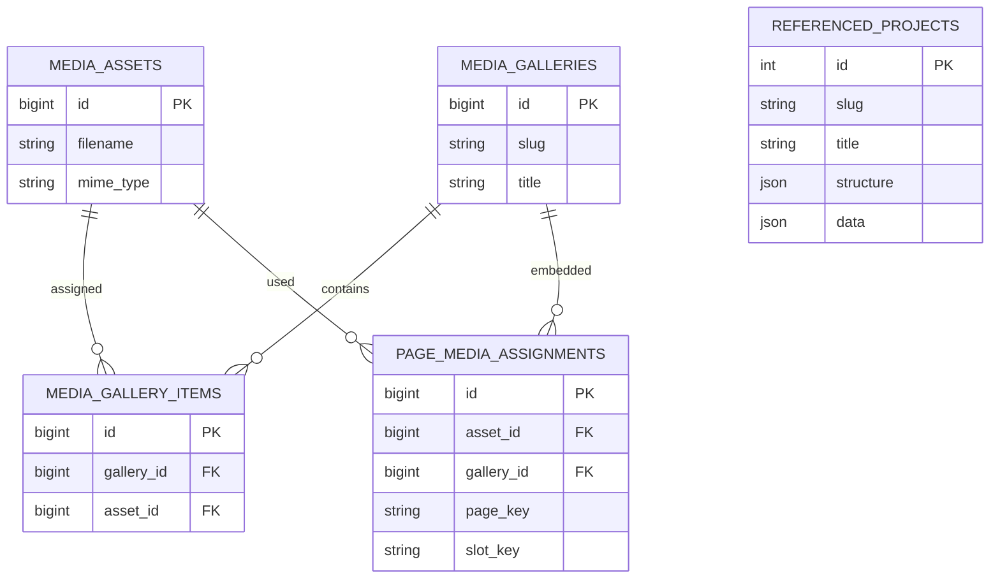

## Referenzprojekte im Operationspanel

Unter `/referenced-projects` lassen sich Referenzprojekte anzeigen, anlegen und
bearbeiten. Der Navigationseintrag und die API erfordern `manage_services`.
Der vorhandene Bereich unter `/services` bleibt ebenfalls verfügbar.

Mit `/referenced-projects/{id}` lässt sich ein Projekt direkt im Editor öffnen.
Die URL wird beim Öffnen einer Tabellenzeile auf die Projekt-ID gesetzt und
kann geteilt oder neu geladen werden. Beim Schließen wird die Übersichts-URL
wiederhergestellt; Zurück/Vorwärts synchronisiert den Editor mit der URL.
Unbekannte IDs werden ausdrücklich als Fehler gemeldet.

Neben den Metadaten können `structure` (JSON-Array) und `data` (JSON-Objekt oder
-Array) direkt bearbeitet werden. Beide Felder werden formatiert angezeigt.
Ungültiges JSON oder eine falsche Wurzelform verhindern das Speichern und werden
als Fehler gemeldet. Leere Objekte bleiben beim Speichern Objekte.

Neben den JSON-Feldern zeigt eine Live-Vorschau die noch nicht gespeicherten
Eingaben mit dem öffentlichen Projekt-Renderer an. Sie aktualisiert sich nach
kurzer Eingabepause, ohne Daten zu speichern. Bei ungültigem JSON wird stattdessen
ein Fehler angezeigt. Auf kleinen Bildschirmen steht die Vorschau unter dem
Editor. Die Vorschau läuft ohne Skripte in einem isolierten iframe.
Splitpanels verwenden die gemeinsamen Theme-Variablen für Flächen, Texte und
Akzente und passen sich damit auf öffentlichen Seiten und in der Vorschau an
den Dark-/Light-Mode an.
Karten, Medienpanels und Splitpanels erhalten gemeinsame, themeabhängige
Box-Shadows; im Light-Mode sind diese dezenter als im Dark-Mode.
Splitpanel-Bilder sind maximal 600 px und höchstens dreimal so hoch wie ihr Bildbereich breit ist.
Bei Erreichen der Höhengrenze wird das gesamte Bild proportional verkleinert,
statt es abzuschneiden oder zu verzerren. Erzwungene Mindest- und Prozenthöhen entfallen.
Unter 768 px werden Splitpanel-Bilder proportional auf maximal 360 px Höhe
verkleinert und horizontal zentriert angezeigt. Der Bildbereich hat mobil keine
Mindesthöhe. Bilder bleiben vollständig sichtbar und überschreiten die
Containerbreite nicht. Ab 768 px gilt die 600-px- beziehungsweise 1:3-Grenze;
auch dort werden Bilder horizontal zentriert.
Intro-Bilder sowie Bilder und Videos in der Referenzübersicht verwenden
`object-fit: contain`: Ihr Seitenverhältnis bleibt auch in festen Bildrahmen
erhalten, ohne Beschnitt. Je nach Bildformat bleiben freie Flächen im Rahmen.

Prüfungen ohne Datenbankzugriff:

```shell
php tests/ReferencedProjectJsonTest.php
node --test tests/admin-services.test.js
```